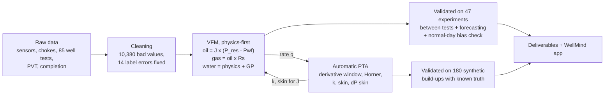

# WellMind — Intelligent Well Performance Analysis

**SOCAR Hackathon 2026 · Team WellMind**

WellMind turns raw per-minute sensor data from gas-lifted wells into two things:
- **daily oil, water and gas rates for every well** — a physics-first virtual flow meter (VFM);
- **automatic interpretation of every shut-in** — a pressure transient analysis (PTA) giving Horner slope, permeability, skin and ΔP skin.

Both run inside one web app. An engineer uploads raw files and gets rates, plots, reservoir properties, an interpretation and the export files.

### How to read this repository

| Order | Read | What you get |
|---|---|---|
| 1 | This README | Deliverables, results, how to run the app |
| 2 | [**docs/METHODOLOGY.md**](docs/METHODOLOGY.md) | The whole method with diagrams: data problems, physics found in the data, model design, validation, the 47-experiment selection, PTA automation, every design decision with its evidence |
| 3 | [**docs/EXPERIMENTS.md**](docs/EXPERIMENTS.md) | Every experiment's numbers (official metrics, both validation schemes, normal-day bias, PTA benchmark) |
| 4 | [`notebooks/FINAL_VFM_PTA.ipynb`](notebooks/FINAL_VFM_PTA.ipynb) | All of it executed end to end, from the raw files to the deliverables |

### Methodology at a glance



---

## Deliverables

| # | Required | Where |
|---|---|---|
| 1 | Result files, Phase 1 (VFM) | [`outputs/VFM_predictions.xlsx`](outputs/VFM_predictions.xlsx) (sheet `predictions`: date, well_name, oil_rate_stbd, water_rate_stbd, gas_rate_mscfd; plus model info, validation, daily details) · [`outputs/VFM_predictions.csv`](outputs/VFM_predictions.csv) |
| 1 | Result files, Phase 2 (PTA) | [`outputs/PTA_results.xlsx`](outputs/PTA_results.xlsx) (sheet `pta_results`: Horner slope, skin, permeability, ΔP skin per build-up test; plus all shut-ins, details, sensitivity, method) · [`outputs/PTA_results.csv`](outputs/PTA_results.csv) |
| 2 | Trained model (.pkl) | [`models/vfm_model.pkl`](models/vfm_model.pkl) |
| 3 | Notebook, all cells run | [`notebooks/FINAL_VFM_PTA.ipynb`](notebooks/FINAL_VFM_PTA.ipynb) — end to end from the raw CSV files to every deliverable (plus the step-by-step research notebooks in [`notebooks/research/`](notebooks/research/)) |
| 4 | Folder with all PTA plots | [`outputs/pta_plots/`](outputs/pta_plots/) — per shut-in: history + Horner + log-log derivative (`*_buildup.png`) and analytical model match (`*_model_match.png`); short unplanned shut-ins in `unplanned_shut_ins/` |
| – | Application | [`backend/`](backend/) (FastAPI) + [`frontend/`](frontend/) (React, pre-built in `frontend/dist`) — see *Run the app* |
| – | Methodology and experiment log | [`docs/METHODOLOGY.md`](docs/METHODOLOGY.md) (diagrams, design decisions) · [`docs/EXPERIMENTS.md`](docs/EXPERIMENTS.md) (all experiment tables) |

---

## Results

**VFM accuracy**
- Metric: the official WAPE = Σ|pred − true| / Σ|true|, against the 85 measured well tests.
- *Between tests* = leave-one-test-out.
- *Forecast* = trained only on tests before a cutoff, then scored on the next 3 months.

| Fluid | Between tests | Forecast 0–3 months | R² |
|---|---:|---:|---:|
| Oil | 2.0 % | 3.5 % | 0.999 |
| Water | 3.1 % | 4.9 % | 0.997 |
| Gas | 4.3 % | 5.6 % | 0.995 |

**PTA — planned build-up tests** (the short shut-ins are analysed in the app but not reported; see *Method*)

| Well | Shut-in | k (md) | Skin | ΔP skin (psi) | Horner m (psi/cycle) | Reading |
|---|---|---:|---:|---:|---:|---|
| GL-01 | 2025-04-15 08:00 | 106.21 | +5.76 | 115.64 | 23.12 | damaged (flow efficiency 0.68) → stimulation candidate; pressure support at ~730 ft |
| GL-04 | 2025-06-03 08:00 | 54.72 | −1.25 | −158.29 | 145.34 | stimulated, infinite-acting |
| GL-08 | 2025-08-19 09:00 | 42.76 | −1.59 | −127.99 | 92.77 | stimulated, infinite-acting |

**Organisers' benchmark scores:** VFM 21.09 / 30 · PTA 12.70 / 20.

---

## Run the app

**Requirements**
- Python 3.12 (we used a conda env called `hackathon`).
- No Node.js needed: the frontend is already built in `frontend/dist`.

```bash
conda create -n hackathon -c conda-forge python=3.12 pip
conda activate hackathon
pip install -r requirements.txt
```

**Start**
- **Windows:** double-click `start_wellmind.bat`.
  - It finds Python itself: a `WELLMIND_PYTHON` variable if set, else a conda env named `hackathon`, else `python` on PATH.
  - It opens the browser as soon as the server is ready.
  - It refuses to start a second copy if port 8000 is already in use.
  - Close its window to stop the app.
- **Any OS**, from this folder:

  ```bash
  python -m uvicorn backend.api:app --port 8000
  ```

  then open **http://localhost:8000**.

About 20 s after start-up the console prints `warm-up done`; from then on every page opens instantly.

**Light / dark mode:** the app opens in light mode. Switch with the moon/sun button at the top right; the browser remembers the choice. You can also force a theme with `?theme=light` or `?theme=dark` in the address, e.g. `http://localhost:8000/?theme=dark`.

**Use it with new data**
1. Go to **Data → Upload well data**.
2. Drop the raw CSV files there. Any subset works and file names don't matter: files are recognised by their columns. Only the per-minute sensor file is required.
3. Missing pieces fall back to the provided data:
   - PVT and completion files → the provided ones;
   - choke file → shut-ins are detected from gas lift stopping;
   - a later period (e.g. Oct–Dec 2025) → cumulative oil and choke state carry over from Jan–Sep.
4. The pipeline runs: validate → clean → features → VFM (stored `.pkl`, no retraining) → shut-in detection, classification and build-up analysis → Excel. Every page then shows the new dataset.

**Pages**

| Page | What it does |
|---|---|
| Overview | Field KPIs, production chart, alerts, per-well table |
| ① Data | Upload, pipeline progress, data-quality report, measurement explorer |
| ② Virtual Flow Meter | **Daily rates:** model card, daily rates per well vs measured tests with a P10–P90 band, reservoir and flowing pressure, well calibration, **IPR and what-if** (lower Pwf, remove skin → oil and $ gain). **Forecast:** next 3–12 months per well and field if operating conditions stay as today, with P10–P90. **Validation:** official metrics, every test measured vs predicted, error by forecast horizon / well / date, paired significance tests, step-by-step build-up, 47-model comparison, test-separator and physics checks |
| ③ Well Test Analysis | **Analysis:** every shut-in with history, log-log derivative, Horner and model-match plots; k, skin, ΔP skin, P*, flow efficiency; radial-flow window adjustable by hand; interpretation. **Validation:** accuracy on 180 synthetic build-ups, Horner vs model-match cross-check, radial-flow quality, build-up vs VFM reservoir pressure, sensitivity of k and skin per event |
| ④ Insights | Stimulation upside ($ at a chosen oil price), gas-lift efficiency, reservoir health vs bubble point, deferred oil, build-up test plan |
| ⑤ Report | Downloads: VFM and PTA results as **Excel or CSV** (CSV in the organisers' template format), all shut-ins CSV, PTA plots ZIP, HTML engineering report (print to PDF), the model `.pkl` |

**Rebuild the frontend** (only after changing it): `cd frontend && npm install && npm run build`.

---

## Re-run the notebook

The 257 MB raw sensor file is not in this repository (GitHub file limit).

1. Put the organisers' `high_freq_data.csv` into `data/data/`; the other raw files are already there.
2. Run `notebooks/FINAL_VFM_PTA.ipynb` from top to bottom (about 2 minutes).

It rebuilds every deliverable and checks itself against our best submissions.

---

## Method in brief

The full version, with diagrams and every design decision, is in [docs/METHODOLOGY.md](docs/METHODOLOGY.md).

**Cleaning**
- Sensors: null codes (−999.25), exact duplicates, one-minute spikes (rolling median).
- Labels: 5 sign flips; GL-06 gas reported in Sm³/d instead of Mscf/d.

**VFM — physics first.** With only 85 labelled tests, pure ML overfits. In our 47-experiment ablation, boosted trees forecast worse than simply repeating the last test.
- **Oil:** q_o = J · (P_res(t) − P_wf).
  - P_wf comes from the downhole gauge every minute.
  - J = k·h / (141.2·Bo·μ·(ln(re/rw) − 0.75 + s)), with k and skin from **our own** build-up analysis. VFM and PTA iterate until k converges.
  - P_res(t) is a local linear trend per well (90-day window) of the pressure implied by the tests.
- **Gas:** q_g = q_o · Rs (solution GOR). The reservoir is above the bubble point, and lift gas is excluded.
- **Water:** ½ physics water-cut trend + ½ Gaussian process.
  - The GP uses only *separator-safe* inputs.
  - Why: during well tests the flow goes to the low-pressure test separator. ML given flowline pressures learns this test-only regime and over-predicts normal days by ~9 %; ours is off by < 1 %.
- **Daily rate** = flowing rate × fraction of the day on stream.

**PTA — automatic build-up analysis**
- **Detection:** shut-ins where the choke is at 0 %.
- **Classification** (textbook definition of a build-up test): duration ≥ 24 h AND a staged choke ramp-up when reopened. Short unplanned shut-ins are shown but not reported.
- **Radial-flow window:** the flattest Bourdet derivative (Agarwal equivalent time).
- **Horner analysis:**
  - Horner line: P_ws = P* − m·log((t_p + Δt)/Δt)
  - Permeability: k = 162.6·q·Bo·μ / (m·h)
  - Skin: s = 1.151·[(P_1hr − P_wf)/m − log(k/(φ·μ·c_t·r_w²)) + 3.23]
  - Skin pressure drop: ΔP_skin = 0.869·m·s
  - Inputs: q = mean VFM oil rate of the 7 days before the shut-in; t_p = 24·N_p/q.
- **Cross-check:** analytical model matching in Laplace space (wellbore storage + skin + infinite / constant-pressure / closed circle), Stehfest inversion, AIC model choice.
- **Validation:** on 180 synthetic build-ups with known truth, automatic Horner recovers k within 2.8 % (median) and skin within ±0.26.

---

## Repository layout

```
backend/        FastAPI app: api.py (endpoints), data.py (results bundles, uploads), pages.py (VFM / Insights), report.py
frontend/       React + Vite + Tailwind + Plotly (src/), pre-built in dist/
src/            engineering code: load, clean, features, vfm, pta, pta_model, pipeline, export, validation, ...
docs/           METHODOLOGY.md (diagrams, design decisions) + EXPERIMENTS.md (all experiment tables)
notebooks/      FINAL_VFM_PTA.ipynb (executed) + research/ (01–15: EDA, cleaning, ablations, PTA development)
models/         vfm_model.pkl
outputs/        result files, validation tables, VFM plots (plots/), PTA plots (pta_plots/)
data/data/      small raw files (PVT, completion, choke events, well tests); put high_freq_data.csv here to re-run
data/bundles/   results bundle of the provided dataset (what the app shows at start); uploads add new bundles
```
