# WellMind — Methodology

How we turned raw well data into daily rates (VFM) and reservoir properties (PTA). Every design choice is listed with the evidence behind it.

- **Experiment log** (every result table): [EXPERIMENTS.md](EXPERIMENTS.md).
- **Executed code:** [../notebooks/FINAL_VFM_PTA.ipynb](../notebooks/FINAL_VFM_PTA.ipynb).
- **Step-by-step research notebooks:** [../notebooks/research/](../notebooks/research/).

**Contents**
1. [The whole pipeline](#1-the-whole-pipeline)
2. [Data: what we found and fixed](#2-data-what-we-found-and-fixed)
3. [Physics we confirmed in the data](#3-physics-we-confirmed-in-the-data)
4. [The final VFM model](#4-the-final-vfm-model)
5. [VFM and PTA feed each other](#5-vfm-and-pta-feed-each-other)
6. [How we validated](#6-how-we-validated)
7. [How we chose the model: 47 experiments](#7-how-we-chose-the-model-47-experiments)
8. [The trap: test-separator effect](#8-the-trap-test-separator-effect)
9. [How the final model evolved](#9-how-the-final-model-evolved)
10. [Automatic PTA](#10-automatic-pta)
11. [How we validated the PTA](#11-how-we-validated-the-pta)
12. [From research to the app](#12-from-research-to-the-app)
13. [Final results](#13-final-results)
14. [Design decisions at a glance](#14-design-decisions-at-a-glance)

---

## 1. The whole pipeline

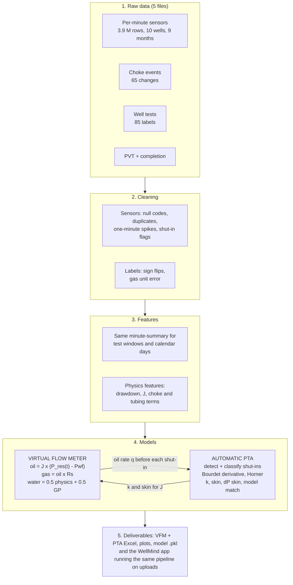

**The central choice.** There are only **85 labelled well tests for 2,730 well-days**. A model that memorises patterns cannot be trusted on new data. So the VFM is built on reservoir physics with 2–3 parameters per well, and machine learning is used only where it measurably adds information.

---

## 2. Data: what we found and fixed

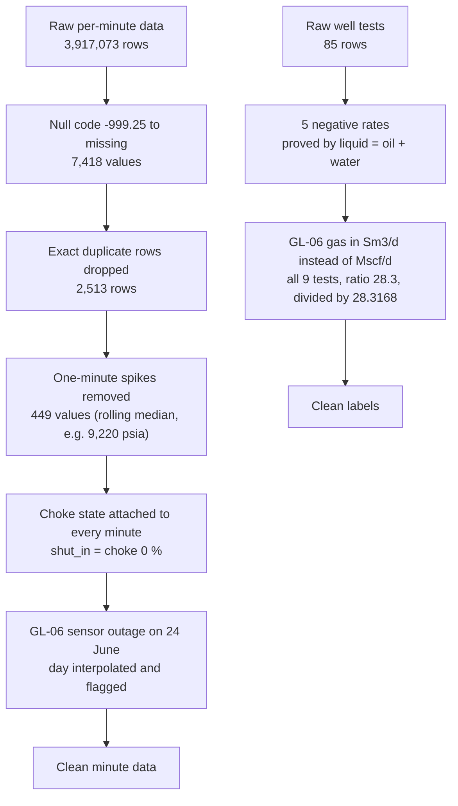

| Decision | Why |
|---|---|
| Remove spikes with a rolling median, not by a fixed limit | A one-minute jump of thousands of psi is physically impossible in a reservoir. A median filter on the 11 neighbouring minutes removes it without touching real fast changes such as shut-ins. |
| Prove every label fix with the data itself | The sign flips are confirmed by liquid = oil + water. The gas unit error shows as gas / (oil × GOR) = 28.3, exactly m³ per Mscf. |
| **Features for tests and days come from one function** (`features.summarize_minutes`) | Training (test windows) and prediction (calendar days) must see identically built inputs. |
| Daily rate = flowing rate × fraction of the day on stream | A day with a shut-in produces less; a fully shut-in day produces 0. |

---

## 3. Physics we confirmed in the data

We built the model only after checking that the data follows these laws.

| Observation | Evidence | Consequence for the model |
|---|---|---|
| **Inflow law holds:** qoil = J·(Pres − Pwf) | Inverting it at each test (Pres = Pwf + q/J) gives a smooth, declining reservoir pressure per well | Oil = productivity index × drawdown |
| Reservoir pressure declines smoothly | The GL-01 build-up ends **1.2 psi** from the VFM reservoir-pressure trend (GL-06: 4.0 psi) | Pres(t) = smooth trend per well |
| **Produced GOR = solution GOR (Rs)** | The reservoir is far above the bubble point (flowing pressure ≥ ~1,230 psi above Pb). Test GOR means are within −5 … +3 % of Rs; the scatter is noise. | Gas = oil × Rs (completion file) |
| Water cut rises linearly with time | Per-well tests; quadratic trends overfit | Water cut = linear trend, recent tests weighted |
| Liquid rate ∝ choke flow term S²·√ΔP | Almost one line across all wells | Choke physics available as ML features |
| Temperature tracks the rate (r = 0.99) | ...but the physics residual vs temperature has r = −0.06 | No new information, not used |
| Remaining test-to-test scatter is noise | WC and GOR deviations correlate with no sensor and alternate in sign | We are close to the measurement-noise floor |

---

## 4. The final VFM model

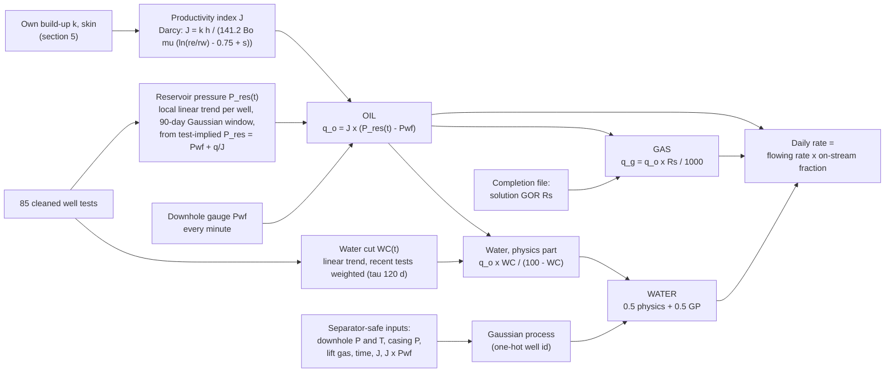

| Component | Choice | Why (evidence in [EXPERIMENTS.md](EXPERIMENTS.md)) |
|---|---|---|
| J | Darcy from our own build-up k and skin (6 wells). Wells without a shut-in: J fitted from their tests, 25 % toward the field-typical value. | Physically grounded and self-contained. Where both exist, own-build-up J beats a J fitted from tests (oil WAPE 1.85 vs 1.93 % between tests, 4.85 vs 5.10 % forecasting). |
| Pres(t) | Local linear trend (Gaussian time weights, bandwidth 90 days) | A constant Pres makes the forecast error explode (17 % MAPE). Quadratic trends overfit (11 %). The local trend follows depletion that speeds up or slows down. |
| Water cut | Linear in time, recent tests weighted (τ = 120 d) | A constant WC multiplies the water error 2.2–2.5×; quadratic overfits. |
| Gas | Oil × Rs from the completion file | Above the bubble point, produced GOR = Rs. The noisy test average is worse on the clean benchmark. |
| Water ML | ½ physics + ½ Gaussian process, **separator-safe inputs only** | Lowers the forecast water error from 5.55 % to 4.92 %. Flowline-based inputs would bias normal days (section 8). |
| Oil and gas ML | None | No ML model beat physics for oil or gas, in either validation scheme. |

---

## 5. VFM and PTA feed each other

PTA needs the oil rate before each shut-in (k = 162.6·q·B·μ/(m·h)). The VFM needs J, which needs k and skin. We solve this chicken-and-egg problem by iterating (`src/own_well_properties.py`):

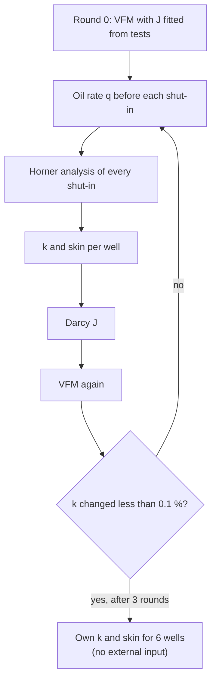

The final model therefore uses only the provided raw data and our own analysis.

---

## 6. How we validated

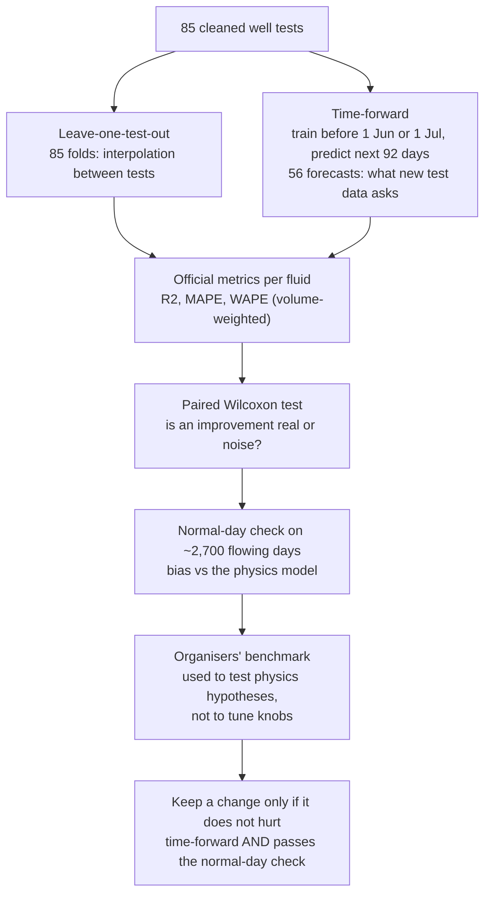

- **Why two schemes.** Leave-one-test-out measures interpolation. Time-forward measures **forecasting**, which is what the judges' later-period data requires. Several models that interpolate well forecast badly.
- **Why WAPE.** R² is ≥ 0.99 for almost every model, so it cannot rank them. WAPE (Σ|error| / Σ|true|) weights high-rate wells, like the official score.
- **Why the normal-day check.** Every label is a test, taken under test-separator conditions. Normal days can only be checked indirectly (section 8).

---

## 7. How we chose the model: 47 experiments

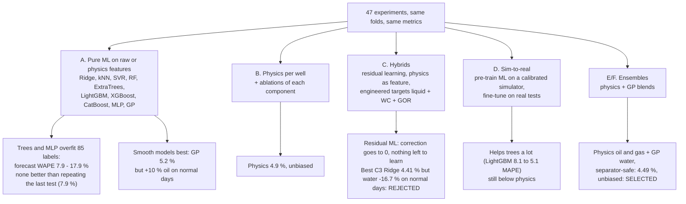

| Lesson | Evidence |
|---|---|
| With 85 labels, flexible models memorise | XGBoost forecast WAPE 13.5–17.9 %, LightGBM 9.5–11.7 %, MLP 15.4 % vs physics 4.9 % |
| Smooth beats complex | GP and Ridge beat every tree model |
| Physics leaves almost nothing systematic | Residual Ridge on top of physics learns a correction of ≈ 0 |
| Synthetic pre-training is real but not enough | It improves trees by 23–43 % (e.g. LightGBM MAPE 8.1 → 5.1 %); still below physics |
| **A model can win the table and still be wrong** | C3 Ridge had the lowest forecast WAPE (4.41 %) but under-predicts water by 16.7 % on normal days → rejected |

---

## 8. The trap: test-separator effect

During a well test the flow goes to the **test separator**, which runs at lower pressure than the production line:

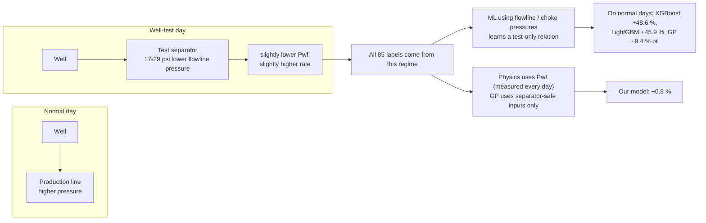

- **Why validation misses it.** Leave-one-test-out and time-forward cannot see this, because every validation point is a test. We found it by comparing models on **normal flowing days** against the physics model.
- **Why physics is a fair reference here.** Its reservoir pressure is confirmed independently by the build-up (1.2 psi).
- **The fix.** The water GP uses only inputs the separator does not disturb.

---

## 9. How the final model evolved

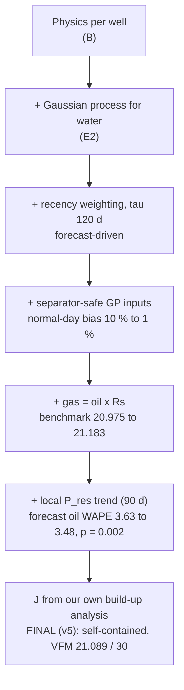

**Hypotheses tested against the organisers' benchmark** (each kept only if time-forward validation agreed):

| Hypothesis | Result | Decision |
|---|---|---|
| Gas = oil × Rs instead of the noisy test-average GOR | 20.975 → **21.183** | kept |
| Water cut from BSW instead of metered water cut | 21.118 (worse) | rejected |
| Local reservoir-pressure trend | **21.224**; forecast oil WAPE 3.63 → 3.48 (p = 0.002) | kept |
| Local water-cut trend | not significant (p 0.28 / 0.75) | rejected |
| Temperature as extra information | residual vs temperature r = −0.06 | rejected |
| Build-up pressures as reservoir-pressure anchors | trend already matches (1.2–4 psi) | no gain |

Step-by-step contribution of each component in the final configuration ([EXPERIMENTS.md](EXPERIMENTS.md#2-final-model-step-by-step)):

| Step | Oil WAPE between / forecast | Water | Gas |
|---|---|---|---|
| Repeat last test (naive) | 3.14 / 8.16 | 4.03 / 5.32 | 5.61 / 10.22 |
| Physics: J × drawdown, trends | 2.08 / 4.12 | 3.39 / 5.53 | 4.33 / 5.39 |
| + recent tests weighted | 2.16 / 3.69 | 3.50 / 5.71 | 4.32 / 4.95 |
| + gas = oil × Rs | 2.16 / 3.69 | 3.50 / 5.71 | 4.40 / 6.00* |
| + local reservoir-pressure trend | 2.03 / 3.52 | 3.38 / 5.55 | 4.33 / 5.63 |
| **+ GP for water = final** | **2.03 / 3.52** | **3.08 / 4.92** | **4.33 / 5.63** |

\* Against the *test labels*, Rs looks slightly worse for gas. The labels carry separator measurement noise, while Rs is the clean physical constant; the benchmark, scored against the noise-free truth, improved.

---

## 10. Automatic PTA

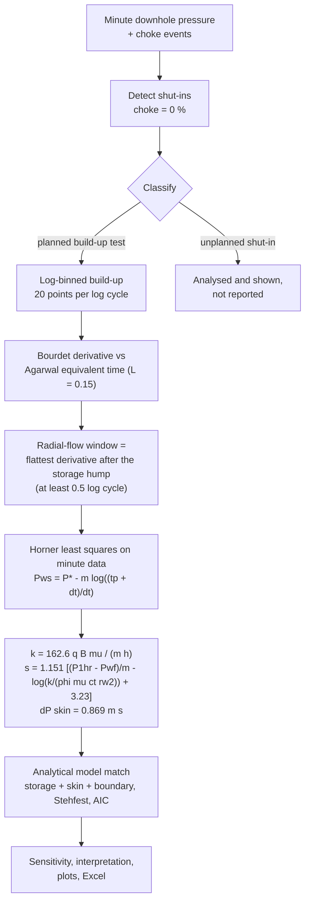

**Classification** (textbook definition of a build-up *test*: a planned operation; Earlougher, Horne):

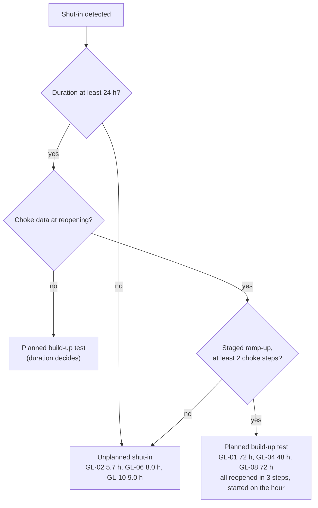

| Input | Choice | Why |
|---|---|---|
| Rate q | Mean VFM oil rate of the 7 days before the shut-in | A single day is noisy; k scales 1:1 with q |
| Pwf(Δt=0) | Mean downhole pressure of the 24 h before the shut-in | Robust to minute noise |
| Producing time | tp = 24·Np/q, Np = cumulative oil at 1 Jan 2025 + VFM oil since | Horner definition; tp ≫ Δt, so its effect is < 0.5 % |
| Window | Automatic from the derivative; adjustable by hand in the app | The standard way to find radial flow without a human picking the line |
| Boundaries | Accepted only if AIC improves by > 4 and the boundary lies inside the radius of investigation | Avoids over-interpreting the end of the build-up |

---

## 11. How we validated the PTA

There is no "true k" for real data. So we built a **synthetic benchmark with known answers** (`src/pta_synthetic.py`, `src/run_pta_benchmark.py`):

| Method | Median \|k error\| | Median \|skin error\| |
|---|---:|---:|
| Model match (best AIC) | 1.2 % | 0.09 |
| Horner on hourly data | 2.6 % | 0.25 |
| **Horner, automatic (ours, deliverable)** | **2.8 %** | **0.26** |
| Superposition Horner | 2.9 % | 0.25 |
| Horner, tp since 2025 | 3.3 % | 0.30 |
| Horner, fixed window 1 h → end | 5.1 % | 0.43 |

**Checks on the real data:**
- **Two independent methods agree:** the GL-01 build-up ends **1.2 psi** from the VFM reservoir pressure, which was inferred from well tests only.
- **Sensitivity of the automatic choices** (window, smoothing, minimum width):
  - k varies ±1.6 % (GL-04) and ±0.1 % (GL-08);
  - GL-01 varies ±3.6 % in k and ±0.43 in skin, because its pressure support cuts radial flow short.
- **Model match vs Horner:** GL-01 112.7 vs 106.2 md, GL-04 54.3 vs 54.7 md, GL-08 42.9 vs 42.8 md.

---

## 12. From research to the app

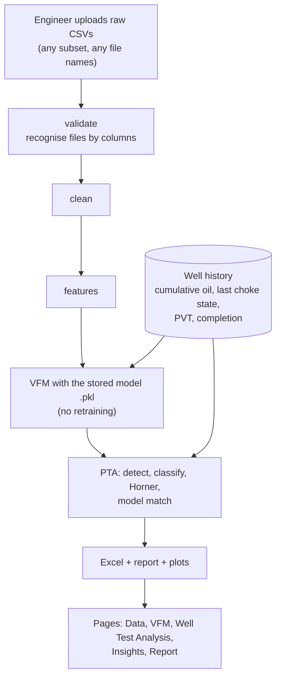

- **Same code.** The app runs exactly the code in `src/` that produced the deliverables (`src/pipeline.py`).
- **Proof.** Uploading only two months of raw files reproduces the GL-08 build-up result to the last digit.
- **Missing files fall back to the stored field data:**
  - PVT and completion → the stored ones;
  - choke file → shut-ins detected from gas lift stopping;
  - a later period → cumulative oil and choke state carried over.

---

## 13. Final results

**VFM**: official metrics, 85 tests

| Fluid | WAPE between tests | WAPE forecast 0–3 months | R² between / forecast |
|---|---:|---:|---|
| Oil | 2.03 % | 3.52 % | 0.999 / 0.996 |
| Water | 3.08 % | 4.92 % | 0.997 / 0.988 |
| Gas | 4.33 % | 5.63 % | 0.995 / 0.993 |

**PTA**: planned build-up tests

| Well | k (md) | Skin | ΔP skin (psi) | Horner m (psi/cycle) | Flow efficiency | Boundary |
|---|---:|---:|---:|---:|---:|---|
| GL-01 | 106.21 | +5.76 | 115.64 | 23.12 | 0.68 | constant pressure, ~730 ft |
| GL-04 | 54.72 | −1.25 | −158.29 | 145.34 | 1.12 | infinite-acting |
| GL-08 | 42.76 | −1.59 | −127.99 | 92.77 | 1.16 | infinite-acting |

**Organisers' benchmark:** VFM 21.09 / 30, PTA 12.70 / 20.

---

## 14. Design decisions at a glance

| # | Decision | Alternatives tested | Deciding evidence |
|---|---|---|---|
| 1 | Physics-first VFM | 10 pure-ML models, hybrids, sim-to-real | Lowest forecast error, unbiased on normal days |
| 2 | Darcy J from **own** build-ups | J fitted from tests | Oil WAPE 4.85 vs 5.10 % forecasting where both exist; physically grounded; self-contained |
| 3 | Local linear Pres trend | constant, linear, quadratic, slope shrinkage | Constant 17 % / quadratic 11 % forecast MAPE; local trend p = 0.002 better |
| 4 | Gas = oil × Rs | test mean / median / linear GOR | Physics above Pb; benchmark +0.21 |
| 5 | Water = ½ physics + ½ GP | GP only, physics only, other blends | Forecast water 5.55 → 4.92 % |
| 6 | GP on separator-safe inputs | GP on all physics features | Normal-day oil bias +9.4 % → +0.8 % |
| 7 | Reject the "best-scoring" C3 Ridge | – | −16.7 % water on normal days |
| 8 | Report only planned build-up tests | report all 6 shut-ins | Textbook definition: ≥ 24 h + staged restart |
| 9 | Automatic Horner for the deliverable; model match as cross-check | 7 other methods | 2.8 % k error on 180 synthetic tests; the required method |
| 10 | q = 7-day mean VFM rate; Pwf = 24-h mean | rate on the shut-in day, last minute | Robust; k scales 1:1 with q |
